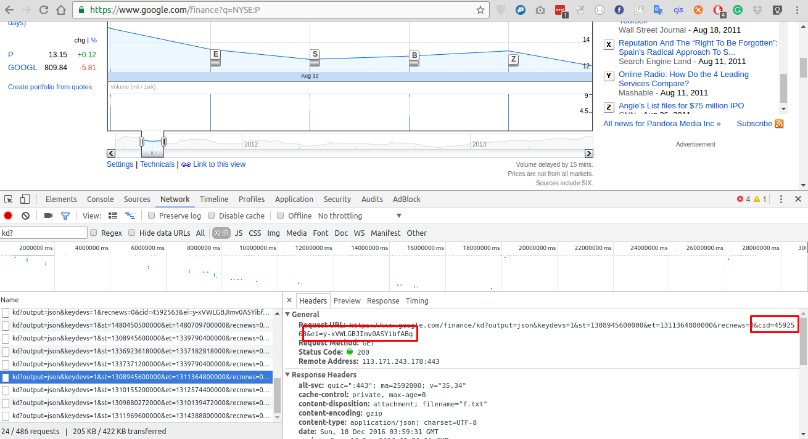

# Google Finance News Crawler

[](https://github.com/duyetdev/google-finance-news-crawler/actions)
[](https://opensource.org/licenses/MIT)
[](https://nodejs.org)

> An elegant, production-ready tool for crawling historical news data from Google Finance. Built with modern JavaScript, comprehensive error handling, and a focus on code quality.

## ✨ Features

- 🚀 **Modern Architecture** - ES6+ modules, async/await, clean code
- 🛡️ **Robust Error Handling** - Retry logic with exponential backoff
- ✅ **Data Validation** - Input validation and schema checking
- 📊 **Progress Tracking** - Real-time progress indicators and statistics
- 🔧 **Configurable** - Environment variables, config files, and CLI options
- 🧪 **Well Tested** - Comprehensive unit tests with high coverage
- 📝 **TypeScript Support** - Type definitions included
- 🎨 **Beautiful CLI** - Colorful output with ora spinners
- 🔐 **Security First** - Input sanitization and path traversal protection
- ⚡ **Rate Limiting** - Respectful crawling with configurable delays

## 📦 Installation

### Requirements

- Node.js >= 18.0.0
- npm >= 8.0.0

### Install Dependencies

```bash
# Clone the repository
git clone https://github.com/duyetdev/google-finance-news-crawler
cd google-finance-news-crawler

# Install dependencies
npm install

# Optional: Install globally to use the CLI anywhere
npm link
```

## 🚀 Quick Start

### 1. Get API Tokens

You need to obtain `CID` and `EI` tokens from Google Finance:

1. Open [Google Finance](https://www.google.com/finance)
2. Open browser DevTools (F12)
3. Go to the Network tab
4. Look for requests to `/finance/kd` endpoint
5. Copy the `cid` and `ei` parameters from the URL



### 2. Configure

Create a `.env` file or use the example:

```bash
cp .env.example .env
```

Edit `.env` with your tokens:

```env
GF_CID=your_cid_here
GF_EI=your_ei_here
START_DATE=2011-06-24
END_DATE=2025-11-16
```

### 3. Run

```bash
# Crawl news data
npm run crawl

# Convert raw data to JSON
npm run convert

# Or use the CLI directly
node src/cli.js crawl --start-date 2024-01-01 --end-date 2024-01-31
node src/cli.js convert
```

## 📖 Usage

### CLI Commands

#### Crawl Command

```bash
node src/cli.js crawl [options]

Options:
  -s, --start-date <date>  Start date (YYYY-MM-DD)
  -e, --end-date <date>    End date (YYYY-MM-DD)
  --cid <cid>              Google Finance CID token
  --ei <ei>                Google Finance EI token
  -o, --output-dir <dir>   Output directory (default: "output")
  -d, --delay <ms>         Delay between requests in ms (default: 1000)
  -c, --config <file>      Config file path
  --dry-run                Dry run mode (no actual requests)
  --verbose                Verbose logging
  -h, --help               Display help
```

#### Convert Command

```bash
node src/cli.js convert [options]

Options:
  -i, --input-dir <dir>    Input directory (default: "output")
  -o, --output-file <file> Output file (default: "pandora.json")
  --no-validate            Skip validation
  --no-deduplicate         Skip deduplication
  --no-sort                Skip sorting
  --verbose                Verbose logging
  -h, --help               Display help
```

#### Validate Command

```bash
node src/cli.js validate <file> [options]

Options:
  --verbose                Show detailed validation errors
  -h, --help               Display help
```

### Using as a Module

```javascript
import { crawlNews, convertToJson } from 'google-finance-news-crawler';

// Crawl news
const stats = await crawlNews({
  startDate: '2024-01-01',
  endDate: '2024-01-31',
  cid: 'your_cid',
  ei: 'your_ei',
  outputDir: 'output',
  delay: 1000,
  onProgress: (current, total, date) => {
    console.log(`Processing ${date} [${current}/${total}]`);
  },
});

// Convert to JSON
const result = await convertToJson({
  inputDir: 'output',
  outputFile: 'news.json',
  validate: true,
  deduplicate: true,
  sort: true,
});
```

### Configuration

You can configure the crawler using:

1. **Environment Variables** (`.env` file)
2. **Config File** (`config.json`)
3. **CLI Arguments**

Priority: CLI > Config File > Environment Variables > Defaults

Example `config.json`:

```json
{
  "cid": "4592563",
  "ei": "y-xVWLGBJImv0ASYibfABg",
  "startDate": "2024-01-01",
  "endDate": "2024-12-31",
  "outputDir": "output",
  "outputFile": "news.json",
  "delay": 1000,
  "maxRetries": 4
}
```

## 📊 Output Format

The crawler generates JSON with the following structure:

```json
[
  {
    "title": "News article title",
    "url": "https://example.com/article",
    "s": "Source name",
    "sp": "Article snippet/description",
    "date": "Jan 1, 2024",
    "timestamp": "1704067200"
  }
]
```

## 🧪 Testing

```bash
# Run all tests
npm test

# Run tests with coverage
npm run test:coverage

# Run tests in watch mode
npm run test:watch
```

## 🔍 Code Quality

```bash
# Lint code
npm run lint

# Fix linting issues
npm run lint:fix

# Format code
npm run format

# Check formatting
npm run format:check

# Type check
npm run typecheck
```

## 🏗️ Project Structure

```
google-finance-news-crawler/
├── src/
│   ├── __tests__/          # Test files
│   ├── utils/              # Utility modules
│   │   ├── date-utils.js   # Date handling functions
│   │   ├── logger.js       # Logging utility
│   │   ├── retry.js        # Retry logic with backoff
│   │   ├── validator.js    # Input validation
│   │   └── file-utils.js   # File operations
│   ├── cli.js              # CLI interface
│   ├── config.js           # Configuration management
│   ├── crawler.js          # Main crawler logic
│   ├── converter.js        # Data conversion
│   └── index.js            # Main entry point
├── output/                 # Raw crawler output
├── docs/                   # Documentation
├── .github/                # GitHub Actions workflows
├── CLAUDE.md              # Project philosophy & architecture
├── README.md              # This file
├── package.json           # Dependencies and scripts
└── .env.example           # Environment variables template
```

## 🤝 Contributing

Contributions are welcome! Please read [CLAUDE.md](CLAUDE.md) for the project philosophy and architecture guidelines.

### Development Workflow

1. Fork the repository
2. Create a feature branch (`git checkout -b feature/amazing-feature`)
3. Make your changes
4. Run tests (`npm test`)
5. Run linter (`npm run lint:fix`)
6. Commit your changes (`git commit -m 'Add amazing feature'`)
7. Push to the branch (`git push origin feature/amazing-feature`)
8. Open a Pull Request

### Code Standards

- Follow the existing code style (ESLint + Prettier)
- Write tests for new features
- Update documentation as needed
- Ensure all tests pass
- Maintain test coverage above 80%

## 📝 License

MIT License

Copyright (c) 2016-2025 Van-Duyet Le

Permission is hereby granted, free of charge, to any person obtaining a copy
of this software and associated documentation files (the "Software"), to deal
in the Software without restriction, including without limitation the rights
to use, copy, modify, merge, publish, distribute, sublicense, and/or sell
copies of the Software, and to permit persons to whom the Software is
furnished to do so, subject to the following conditions:

The above copyright notice and this permission notice shall be included in all
copies or substantial portions of the Software.

THE SOFTWARE IS PROVIDED "AS IS", WITHOUT WARRANTY OF ANY KIND, EXPRESS OR
IMPLIED, INCLUDING BUT NOT LIMITED TO THE WARRANTIES OF MERCHANTABILITY,
FITNESS FOR A PARTICULAR PURPOSE AND NONINFRINGEMENT. IN NO EVENT SHALL THE
AUTHORS OR COPYRIGHT HOLDERS BE LIABLE FOR ANY CLAIM, DAMAGES OR OTHER
LIABILITY, WHETHER IN AN ACTION OF CONTRACT, TORT OR OTHERWISE, ARISING FROM,
OUT OF OR IN CONNECTION WITH THE SOFTWARE OR THE USE OR OTHER DEALINGS IN THE
SOFTWARE.

## 🙏 Acknowledgments

- Original concept and implementation by [Van-Duyet Le](https://github.com/duyetdev)
- Modernized and enhanced with ❤️ for the open source community

## 📬 Support

- 🐛 [Report a bug](https://github.com/duyetdev/google-finance-news-crawler/issues)
- 💡 [Request a feature](https://github.com/duyetdev/google-finance-news-crawler/issues)
- 📖 [Documentation](https://github.com/duyetdev/google-finance-news-crawler)

---

**Built with care. Made with modern JavaScript. Open source forever.** 🚀
